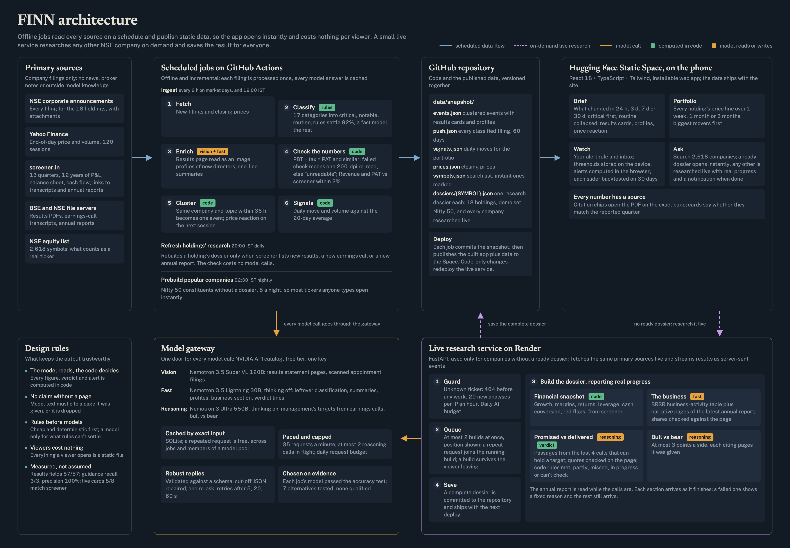

# FINN — a financial investment agent that tells you less

**Try it on a phone:** https://ayush-rai-230265-finn.static.hf.space

FINN is a mobile-first web app for an investor who holds 18 Indian stocks. It has three tabs:

- **Brief:** what changed across the portfolio in a time window you choose, with the few things that matter on top and everything routine collapsed.
- **Watch:** alerts on the thresholds *you* set: filing types you care about, volume spikes, price moves. Each slider shows how often it would have fired over the last 30 days.
- **Ask:** a research dossier on any NSE company, built only from its own filings, annual report and earnings-call transcripts, with every claim linked to the exact PDF page.

## Point of view

The scarce skill is not collecting information but deciding what to ignore, so FINN makes that decision explicit and checkable:

- **Every filing gets one of three tiers.** Critical items get a rich card, notable items a one-line summary, routine items a collapsed count. The tier rules are code you can read (`backend/finn/push/classify.py`), not a model's mood. For example, a subsidiary's incorporation or an NCD allotment is filed as "M&A" or "fund raise" but is housekeeping, so it is not critical.
- **The model reads, the code decides.** LLMs extract numbers and quotes; code computes every figure, verdict and threshold. Results cards must pass the statement's own arithmetic (PBT − tax = PAT, and so on) or they are marked unreadable rather than shown wrong. They are also cross-checked against screener.in's reported quarter.
- **Analyse management, don't summarise it.** The research view leads with *Promised vs Delivered*:
  - The model pulls each explicit numeric target out of the last four concall transcripts.
  - Code measures what the reported quarters actually delivered and rules met, partly, missed, in progress, or can't check.
  - The model then writes one line explaining a verdict it cannot change.
- **No claim without a page.** Every model-written sentence must cite a source page FINN actually sent it, or it is dropped. The citation chips open the PDF at that page.

## What's in it

**Push**
- **Windowed digest** (24 h / 7 d / 30 d), prioritised by tier. Filings about the same thing within 36 h (results + press release + newspaper ad + auditor's report) fold into one event.
- **Results cards:** Revenue, EBITDA, PBT and PAT, this quarter vs QoQ and YoY.
  - Read from the statement page image by a vision model, with column selection and unit conversion (₹ crore / lakh / million) done in code.
  - Lenders automatically get NII / PPOP / PBT / PAT, since EBITDA is meaningless for a bank.
  - A card that fails its arithmetic gets one 200-dpi re-read, else "Couldn't read the numbers — open filing".
- **Management changes:** a profile of the incoming person (role, background, prior roles) taken from the appointment filing itself, which SEBI requires to include one. Scanned filings are read as images.
- **Other material filings** get a one-line summary; routine ones get none.
- **Price reaction** on the first trading session after each event.
- **Alerts:**
  - per-category toggles
  - volume ≥ N× its 20-day average, and price moves beyond ±X%
  - the badge and inbox update on the scheduled refresh

**Pull (any NSE ticker)**
1. **Financial snapshot:** last-four-quarter revenue and profit, 3-year growth, margins (computed from rows, not screener's rounded column), ROCE/ROE, debt-to-equity, cash conversion (CFO ÷ PAT), eight-quarter sparklines, and plain-English red flags. A missing number shows as "—", never 0.
2. **Promised vs delivered:** as above. For example, Pidilite: "20–24% EBITDA margin corridor" for FY26 was **met** at 24.1%, and FY27 is **in progress** at 26.2% after one quarter.
3. **The business:** what it sells and to whom, plus segments with their share of turnover. Shares come from the annual report's BRSR "business activities" table and are blanked unless printed on the cited page.
4. **Bull vs bear:** at most three cited points each side, from the stronger reasoning model.

Four demo tickers (PIDILITIND, HAL, CDSL, NAUKRI) and all 18 holdings are precomputed and open instantly. Any other ticker is researched live on the server, and its sections stream in as they finish.

**Every dossier is built once and kept current:**
- **Saved permanently.** A finished live dossier is committed to the repo next to the precomputed ones (`finn/persist.py`). The server replays it from there instead of rebuilding, and the next deploy makes it a static, instant page. A dossier with a failed section is never saved.
- **Holdings always present and current.** A daily job (`.github/workflows/dossiers.yml`, 20:00 IST) checks the 18 holdings only:
  - builds any missing dossier and retries any with a failed section
  - rebuilds a dossier when its inputs changed: each one records the latest results quarter, concall and annual report it used, and the job compares that with screener.in (no model calls)
  - older transcripts come from the LLM cache, so a rebuild pays only for what is new
- **Other companies are not refreshed.** Demo tickers and companies researched live keep the dossier as built.
- **Freshness is visible.** Each dossier says what it covers: "Covers results to Sep 2026, the Aug 2026 call and the FY26 annual report. Updated 28 Oct 2026."

## Architecture



The diagram's source is [docs/architecture/architecture.html](docs/architecture/architecture.html); re-render with headless Chrome at 1800×1250, scale 2.

```
GitHub Actions (every 2 h on market days + 19:00 IST)
  NSE announcements ─┐
  yfinance EOD ──────┼─► classify (rules, then LLM for leftovers) ─► enrich (vision / bulk LLM) ─► cluster
  screener.in ───────┘                                                    │
                                                    commit data/snapshot/*.json ─► redeploy the static Space
Hugging Face Static Space: React PWA + snapshot JSON + precomputed dossiers  (Brief, Watch, demo dossiers)
Render (free): FastAPI, only for live research on tickers without a precomputed dossier (SSE);
  a finished live dossier is committed back to the repo, so it ships with the next deploy
GitHub Actions (daily 20:00 IST): build missing, failed and outdated holding dossiers ─► commit ─► redeploy
```

- **Viewers cost nothing.** Brief and Watch, and every precomputed dossier, are static files, so a viewer triggers no model call.
- **Ingestion is incremental and cached.** Each filing is classified and enriched once, and every model response is cached in SQLite by its exact input.
- **Live research is queued and guarded:**
  - an unknown ticker gets a 404 before any work
  - at most 2 analyses build at once, and the rest wait in line with their position shown
  - a second request for a company already building joins that build
  - builds keep running if the viewer leaves, and the app shows a banner (or a system notification, if allowed) when one finishes
  - up to 20 new analyses per IP an hour, plus a daily request budget
  - a real progress bar counts completed steps
  - if screener.in can't be reached, the user gets a clear message, not a crash

## Models and cost

The NVIDIA API catalog's free tier, one key, each tier routed to the job it fits:

| Tier | Model | Used for |
|---|---|---|
| vision | `nemotron-3.5-super-vl-120b-a12b` | Results statement pages, scanned management filings |
| bulk | `nemotron-3.5-lightning-30b-a3b` (thinking off) | Leftover classification, one-line summaries, profiles, business section, verdict explanations |
| reason | `nemotron-3-ultra-550b-a55b` (thinking on) | Guidance extraction, bull vs bear |

**Choices made on evidence, not by default:**
- **Results go to the vision model.** On real filings it scored 97% vs 18% for OCR text and 3% for a document parser (`docs/spikes.md`).
- **Guidance went to the reasoning model.** The bulk model mislabelled past results and volume growth as revenue targets; the reasoning model returned only the real one.
- **Rules classify about 92% of filings** before any model is called.

**Cost: ₹0.**
- All development, ingestion and 22 precomputed dossiers so far took 465 model calls (154 bulk, 20 vision, 291 reason) on the free tier.
- A viewer of the deployed app costs nothing.
- The reasoning tier is capped at 2 calls in flight to stay inside the free rate limit.

## Accuracy

`make eval` scores extraction against gold values I read by hand from the rendered PDF pages (`backend/eval/`):

| | Gold set | Score |
|---|---|---|
| **Results fields** (within 0.5%) | 5 filings: INFY, HDFCBANK (bank), BAJFINANCE (NBFC), PIDILITIND Q4 (with full-year columns), POLYCAB (₹ million) | **57/57** |
| **Guidance targets** (metric + period + value) | 3 calls: PIDILITIND, HAL, CDSL (CDSL has none, which tests precision) | **recall 3/3, precision 100%** |
| **Live results cards vs screener.in** (2% tolerance) | every card in the current snapshot | **8/8 verified** |

The gold set is small, so read this as "no known errors on a deliberately varied sample", not as a population rate.

## Testing

- **Coverage:** 192 backend tests (pytest) and 20 web tests (Vitest).
- **Where the tests sit:** on the logic a wrong answer would hide in. That means tier rules, column selection and unit conversion, the arithmetic checks, event clustering, signals, the verdict matrix, the citation guard, the rate limiter and the API's refusal paths.
- **Fakes vs real:** model calls are faked in tests. Real fixtures (NSE JSON, screener pages, results PDFs, a transcript) pin the parsers.

## Deliberately left out

- **Balance-sheet deep-dive, working-capital cycle, narrative-vs-numbers on the annual report:** Promised vs Delivered covers the brief's favourite analysis more rigorously.
- **LinkedIn bios:** the appointment filing is a primary source and always available. Scraping LinkedIn is brittle and against its terms.
- **Web push notifications:** alerts update on each scheduled refresh; push would need a service worker and subscription storage.
- **Intraday or real-time feeds:** the brief's data is end-of-day.
- **Natural-language chat over the dossier:** a fixed, cited structure is easier to trust and faster to scan than a chat transcript.

## Next

1. **Natural-language questions over a dossier,** answered only from its cited pages.
2. **Swipe to triage Brief cards,** with dismissals that teach the tier rules.
3. **Web push** for critical alerts.
4. **A real-time exchange feed** instead of 2-hourly polling.
5. **Accounts,** so each investor has their own portfolio.
6. **Grading regulatory fines by size** against revenue.

## Run it locally

```bash
cp .env.example .env            # NVIDIA_API_KEY=… (free at build.nvidia.com)
cd backend && uv sync && uv run pytest -q
uv run python -m finn.ingest --days 7          # writes data/snapshot/
uv run python -m finn.pull.dossier --symbols PIDILITIND
cd ../web && npm install && npm run dev        # http://localhost:5173
make eval                                      # accuracy tables
make api                                       # live research server on :8000
```

## How it was built

- **Builder:** Claude Code (Opus) in one long session, working from a written plan that was reviewed and revised before any code.
- **The plan:** [docs/superpowers/plans/2026-10-28-finn.md](docs/superpowers/plans/2026-10-28-finn.md)
- **Data-source spikes and the decisions they forced:** [docs/spikes.md](docs/spikes.md)
- **Task-by-task progress log:** [docs/PROGRESS.md](docs/PROGRESS.md)
- **The requests that directed the build, with outcomes (curated):** [docs/PROMPTS.md](docs/PROMPTS.md)
- **Full session transcripts:** [docs/build-history/](docs/build-history/), both readable Markdown and raw `.jsonl` (secrets and email redacted)
